# Персональная память ребёнка в образовательном ИИ ассистенте

Хранение и поиск сведений в TeachCopilot

Отчёт по научно-исследовательской работе

7 ноября 2026 года

## Аннотация

Работа посвящена персональной памяти образовательного ИИ-ассистента, который использует сведения прошлых занятий при подготовке следующего шага и ответе ученику. Исследованы девять способов представления памяти и отдельно сопоставлены пять режимов поиска. Реализована архитектура с каноническим архивом исходных реплик, производными индексами, проверяемым отбором контекста и подтверждением доступа преподавателем.

На трёх синтетических историях выполнены 360 успешных поисковых попыток для 90 сочетаний условий. По сохранённым контекстам сформированы 90 ответов. Повторная слепая автоматическая оценка дала 50 верных, 8 частично верных и 32 неверных ответа. Графовый гибрид получил 13 верных ответов из 18, векторный и комбинированный поиск – по 12. Медиана собственно поиска составила 183,1 мс у графового гибрида и 60,1 мс у комбинированного поиска. Эти результаты описывают небольшой синтетический корпус и различия полных поисковых процедур.

Для практического внедрения выбран комбинированный поиск по разрешённым исходным репликам. Он объединяет лексическое сопоставление с векторным сходством и использует кеш векторов. Добавлены сохраняемые сводки последних одного и семи завершённых сеансов с датами, ролями авторов, исходными цитатами и цепочками исправлений. Графовый вариант сохранён для исследования связей и дальнейших сравнений. Учебные достижения детей и педагогическая полезность персонализации требуют отдельной оценки на реальных занятиях.

Ключевые слова – персональная память, образовательный ИИ, RAG, комбинированный поиск, векторный поиск, граф знаний, Graphiti, LangGraph, сводка занятия.

## Содержание

Введение
1 Задача персональной памяти
2 Способы представления памяти
3 Поиск по персональной истории
4 Реализация в TeachCopilot
5 Организация эксперимента
6 Результаты и их интерпретация
7 Обсуждение и выводы
Заключение
Список использованных источников
Приложение А Воспроизводимость

## Введение

Образовательный ассистент должен связывать текущую задачу с предыдущими занятиями ребёнка. Для следующего шага важны ошибка, вопрос преподавателя, подсказка и самостоятельность ответа. Личная деталь также может быть полезна. Ребёнок мог придумать персонажа, выбрать сюжет задачи или оставить дело, к которому хочет вернуться.

История постепенно превышает окно модели. Однотипные упражнения вытесняют редкие события. Пересказ сокращает объём, однако может потерять исходную ошибку или превратить разовый выбор в постоянный интерес. Исследовательская задача состоит в сохранении проверяемых сведений и выборе части истории для конкретного запроса.

Объект исследования – долговременная персональная память образовательного ИИ-ассистента. Предмет исследования – представления сведений и процедуры их отбора при ограниченном контексте. Цель работы – исследовать способы памяти и реализовать в TeachCopilot прототип, который использует подтверждённые источники ребёнка при подготовке следующего занятия и продолжении диалога.

В работе решаются пять задач. Определяются требования к исходным сведениям и их происхождению. Сопоставляются простые текстовые, структурированные и графовые способы памяти. Реализуется комбинированный поиск с управляемым доступом. Разрабатываются сводки одного и семи завершённых сеансов. Экспериментально проверяются техническое выполнение, полнота извлечения и содержание ответов.

Метод включает анализ публикаций, проектирование прототипа, вычислительный эксперимент, регрессионные проверки и отдельную автоматическую оценку ответов. Генерация и векторизация выполняются локально. Для смысловой проверки сохраняются источники, ответы и контрольные суммы.

Архитектурная гипотеза состоит в том, что разделение истории, индексов и контекста помогает сохранять происхождение сведений и локализовать ошибки.

## 1 Задача персональной памяти

### 1.1 Связь между занятиями

Внешняя память хранит события за пределами параметров языковой модели. Канонический архив сохраняет наблюдаемые реплики. Поисковые представления помогают найти подходящие события. Контекст ответа содержит ограниченный набор разрешённых источников, выбранных под текущий вопрос.

В подходе Retrieval-Augmented Generation, представленном Lewis и соавторами, генератор использует материалы внешнего индекса. В TeachCopilot этот принцип применяется к истории взаимодействия с конкретным ребёнком. Каждый найденный фрагмент должен сохранять связь с оригиналом, поскольку смысл короткого ответа зависит от задания, помощи и роли собеседника.

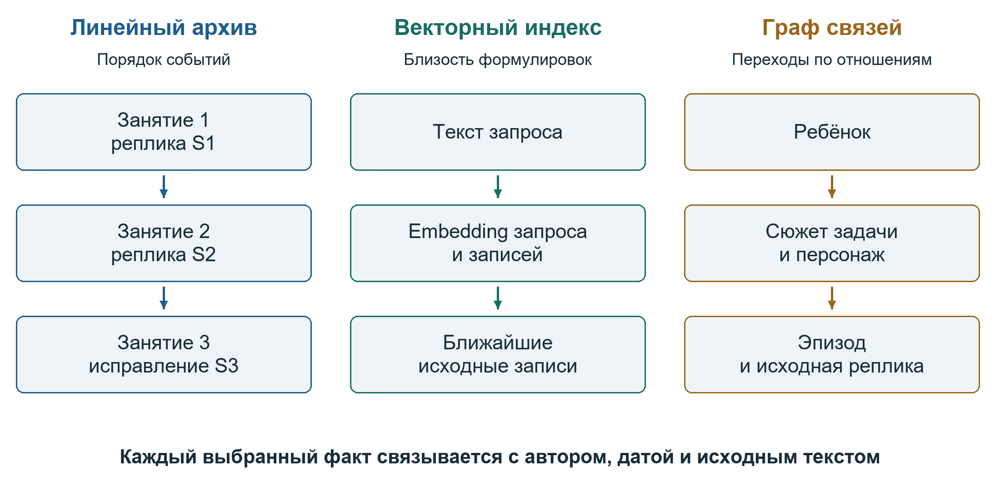

Рисунок 1 – Три способа обращения к одной истории и общая связь с первоисточником

Линейный просмотр сохраняет порядок занятий и удобен для восстановления недавней последовательности. Векторный индекс помогает находить близкие по смыслу формулировки. Граф добавляет явные связи между сущностями, темами и эпизодами. Эти представления могут использовать один архив и давать разные наборы кандидатов.

### 1.2 Состав сохраняемых сведений

Учебное событие включает условие задания, первый ответ, ошибку, помощь, исправление и результат. Личное событие может содержать конкретную просьбу, выбор сюжета или название персонажа. Для обеих групп нужны дата, сеанс, автор и ссылка на исходную реплику. Исправление связывается с прежней записью, чтобы история изменения оставалась доступной.

Таблица 1 – Требования к персональной памяти

| Требование | Сохраняемые сведения | Назначение |
|---|---|---|
| Происхождение | Реплика, роль автора, сеанс | Проверка утверждения по оригиналу |
| Контекст | Вопрос, условие, помощь | Различение ответа и самостоятельного решения |
| Актуальность | Дата и цепочка исправлений | Использование действующего уточнения |
| Доступ | Подтверждённый набор источников | Ограничение контекста решением преподавателя |
| Объём | Бюджет выбранной памяти | Работа в пределах окна модели |
| Повторяемость | Версии, параметры, контрольные суммы | Воспроизведение конкретного результата |

Разовый выбор темы даёт основание сохранить факт выбора. Для вывода об устойчивом интересе нужны дополнительные наблюдения. Реплику «не знаю» следует хранить рядом с соответствующим вопросом. Указание на объект изображения сохраняет смысл только при доступности самого изображения или достаточного текстового описания.

### 1.3 Измерения качества

Техническая проверка устанавливает завершение операции и соблюдение контрактов. Полнота извлечения измеряет долю эталонных источников в контексте. Смысловая оценка рассматривает ответ, поддержку цитатами и обоснованность вывода. Направления LongMemEval, предложенные Wu и соавторами, использованы для вопросов о межсессионной информации, изменениях и отказе от ответа.

## 2 Способы представления памяти

### 2.1 Простые текстовые способы

В исследовательском стенде реализованы девять условий. Первые три задают простые границы доступности истории. Условие без истории получает общий профиль и текущий вопрос. Последние реплики передают ограниченный конец диалога. Последовательное резюме обновляет краткий пересказ после очередного занятия.

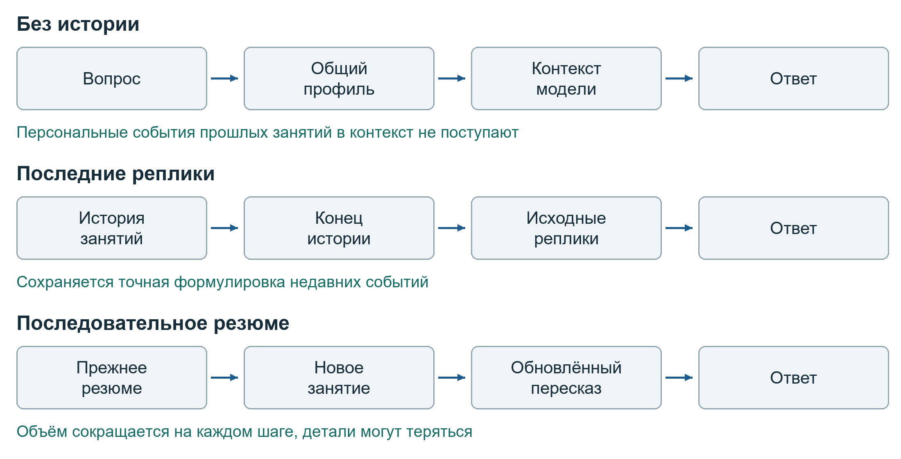

Рисунок 2 – Текстовые способы памяти и преобразования перед ответом

Последние реплики сохраняют точную формулировку недавнего события, но старые детали вытесняются по мере роста истории. Резюме позволяет удерживать более широкий период в меньшем объёме. При многократном обновлении пересказа возможны накопленные потери, особенно для исправлений, контекста помощи и редких личных событий.

### 2.2 Структурированные записи и граф учебных тем

Структурированная память V1 представляет учебное наблюдение через поля ошибки, помощи, результата и источников. V2 расширяет состав событий, отдельно выделяя кандидаты интересов, просьбы на текущее занятие и случайные факты. Выразительность схемы зависит от способности извлекателя правильно классифицировать событие и сохранить существенную цитату.

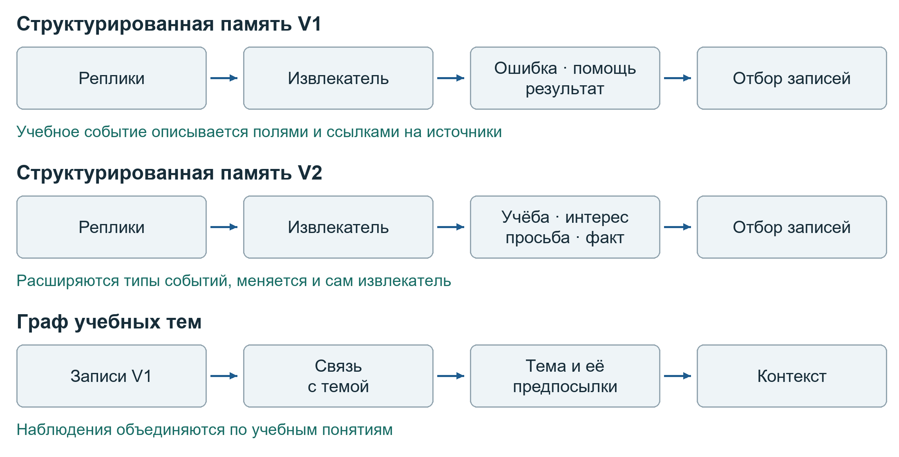

Рисунок 3 – Структурированные способы памяти и связь наблюдений с учебной темой

Граф учебных тем связывает наблюдения V1 с понятиями и предпосылками. Такая структура поддерживает переходы между связанными учебными задачами. Она наследует ошибки общего извлекателя V1. Сравнение V1 и V2 также включает изменение извлекателя, поэтому наблюдаемое различие качества относится к целым реализациям.

### 2.3 Библиотечные и гибридные способы

Mem0 выполняет извлечение, консолидацию и поиск воспоминаний. В публикации Chhikara и соавторов описана память для длительного взаимодействия и отдельный графовый вариант. В проекте результат Mem0 связывается с занятием, после чего подгружается архивный материал. Точность связи с конкретной подтверждающей репликой проверяется отдельно.

Graphiti представляет эпизоды, сущности и связи. Архитектура Zep, описанная Rasmussen и соавторами, использует временной граф памяти. В TeachCopilot граф служит производным индексом. После получения кандидата система обращается к исходным репликам, по которым можно проверить найденную связь.

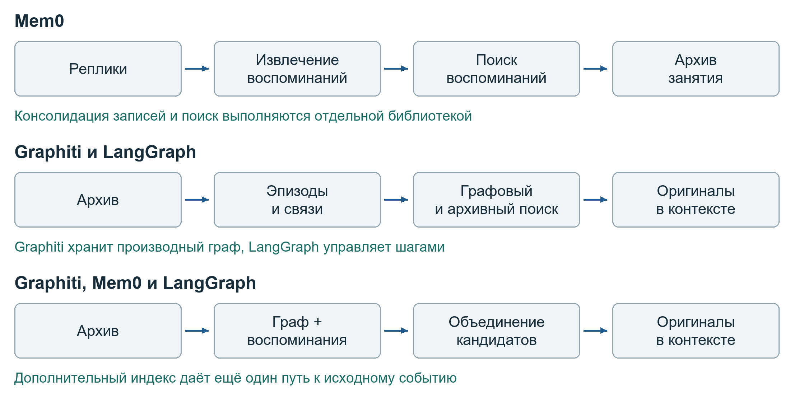

Рисунок 4 – Библиотеки памяти и два гибридных способа доступа к исходным событиям

LangGraph задаёт последовательность узлов обработки и переходов между ними. Его состояние описывает ход вычисления. Граф Graphiti представляет сведения предметной области. В гибридном варианте LangGraph организует поиск по графу и архиву, объединение кандидатов и формирование ограниченного контекста.

### 2.4 Сопоставление представлений

Таблица 2 – Девять условий исследовательского стенда

| Условие | Что передаётся дальше | Основное ограничение |
|---|---|---|
| Без истории | Общий профиль | Прошлые события недоступны |
| Последние реплики | Конец исходного диалога | Старое вытесняется новым |
| Резюме | Обновляемый пересказ | Потери при сжатии |
| V1 | Учебные наблюдения | Ошибки извлекателя |
| V2 | Несколько типов событий | Ошибки типизации |
| Граф тем | V1 и учебные связи | Ограниченный состав личных сведений |
| Mem0 | Найденные воспоминания | Требуется проверка точного источника |
| Graphiti и LangGraph | Графовые и архивные кандидаты | Дополнительные вызовы и ошибки связей |
| Graphiti, Mem0 и LangGraph | Кандидаты двух индексов | Рост стоимости и сложности |

## 3 Поиск по персональной истории

### 3.1 Пять поисковых режимов

Хронологический режим отдаёт приоритет недавним записям. Лексический режим ищет совпадения слов. Векторный режим ранжирует тексты по близости представлений. Комбинированный режим объединяет лексические и векторные ранги. Графовый гибрид дополнительно использует связи и эпизоды графа для поиска архивных кандидатов.

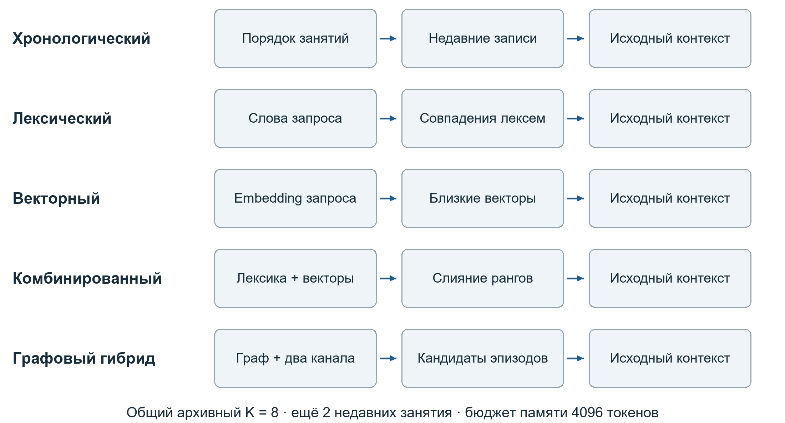

Рисунок 5 – Маршруты пяти режимов поиска в контролируемом сравнении

В исследовательском архиве лексический поиск реализован средствами PostgreSQL с русской конфигурацией, plainto_tsquery и ts_rank_cd. Нормализованные слова запроса соединяются условием «И», а ранжирование учитывает близость совпавших лексем. При длинной перефразировке обязательность всех сохранившихся терминов может приводить к отсутствию попаданий. Поиск приложения по разрешённым репликам использует отдельное сопоставление наборов токенов.

### 3.2 Что добавляет граф

Граф позволяет перейти от сущности к связанному эпизоду, учитывать отношения между темами и представлять изменение факта во времени. Например, связь персонажа с занятием может вывести поиск к исходной реплике, даже если вопрос и реплика сформулированы по-разному. Польза зависит от корректного извлечения связи и последующего отбора оригинала.

JSON и JSONB сохраняют сериализованное содержимое записей. Графовая база хранит узлы и отношения, по которым можно выполнять переходы. В реализованной архитектуре канонический архив PostgreSQL сосуществует с производным графом Neo4j. Сохранение исходника позволяет восстановить контекст и проверить ошибочно извлечённую связь.

Дополнительный графовый канал требует построения и проверки индекса, сетевых запросов и согласования нескольких представлений. В сравнении пяти режимов общий предел архивных кандидатов одинаков, однако графовые запросы добавляют вычисления. Поэтому полученные различия отражают работу полного поискового маршрута.

### 3.3 Почему для внедрения выбран комбинированный поиск

Комбинированный поиск даёт два способа найти исходное событие. Лексический канал полезен для точного имени, термина или формулировки. Векторный канал поддерживает смысловую близость при перефразировании. Объединение рангов и удаление повторов позволяют передать модели общий набор первоисточников.

На исследованном корпусе комбинированный и векторный режимы дали одинаковое распределение новых оценок. Дополнительный выигрыш комбинирования в качестве ответа на этой выборке не установлен. Выбор комбинированного режима для приложения основан на возможности совместно использовать точные совпадения и семантический поиск при небольшой стоимости относительно графового маршрута.

## 4 Реализация в TeachCopilot

### 4.1 Комбинированный поиск по подтверждённым источникам

Новый метод personal_memory использует канонические источники PostgreSQL и кеш векторов BGE-M3. Перед поиском в чате проверяются тема, версия, доступ преподавателя и соответствие снимка. Затем выполняются лексическое сопоставление и векторный поиск. Группы реплик и исправлений выбираются совместно. Графовый personal_graph сохранён как отдельный экспериментальный маршрут.

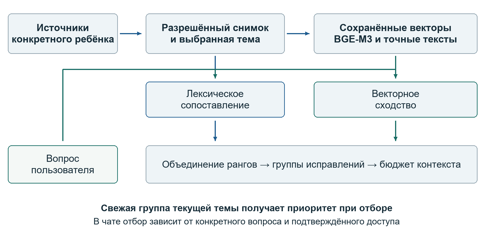

Рисунок 6 – Практический маршрут комбинированного поиска по разрешённым источникам

Для общего преподавательского запроса «что делать дальше» после ранжирования свежая подходящая группа источников текущей темы получает приоритет при отборе. Она входит в контекст, если целиком помещается в бюджет. Это поддерживает тематическую опору при наличии большого архива других занятий. Вопрос ученика обрабатывается своим поисковым запросом. Политика общего запроса включена в версию рецепта отбора и диагностические поля.

Векторы исходных текстов кешируются с учётом ребёнка, точного содержимого, модели и рецепта обработки. Вектор текущего вопроса вычисляется отдельно. При повторном использовании проверяется идентичность модели и допустимость размера вектора. Изменение содержимого или конфигурации ведёт к новому ключу, что исключает использование прежнего результата под обновлёнными условиями.

### 4.2 Сводки одного и семи сеансов

Сводка одного сеанса представляет последнее завершённое занятие. Сводка семи сеансов объединяет последние семь завершённых занятий в определённом порядке. В интерфейсе показывается фактический диапазон дат. Если за день завершено несколько занятий, они учитываются как отдельные сеансы. Активное занятие входит в окно после завершения.

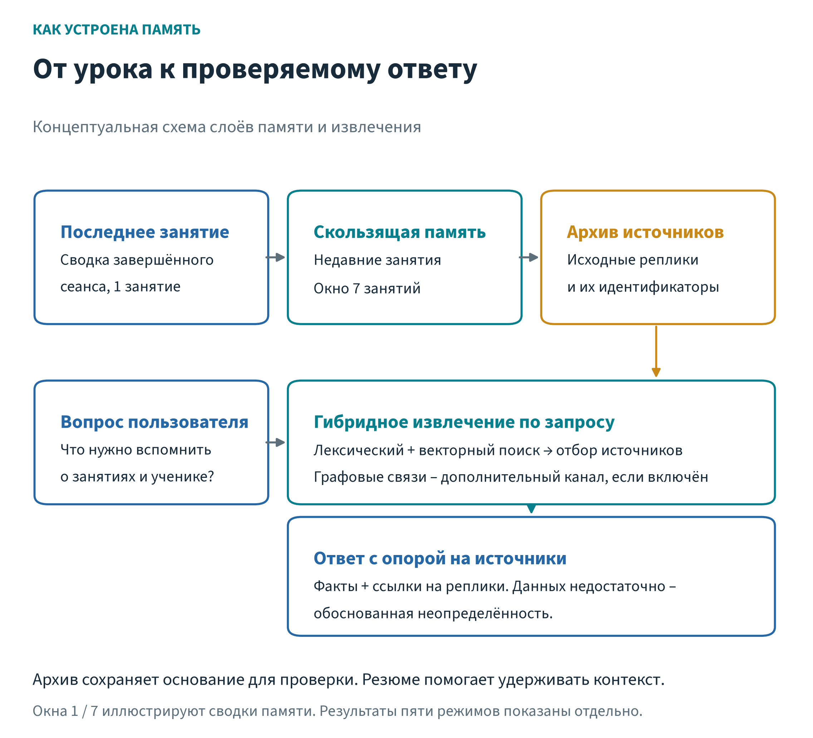

Рисунок 7 – Канонический архив сводки сеансов и поиск для нового запроса

Реализована извлекающая сводка extractive_v1. Для каждого занятия выбираются до трёх буквальных фрагментов длиной до 120 символов. Приоритет получают исправления, затем лексические упоминания неуверенности, интереса и прочие наблюдения. Укороченные цитаты и число пропусков явно отмечаются. Автоматическая метка сообщает о словесном признаке в тексте и сохраняется вместе с исходной формулировкой.

Сводка содержит идентификаторы реплик, роли, время и цепочку исправлений. Версии сохраняются в PostgreSQL вместе с отпечатком входных данных и ссылкой на предшествующую версию. Поздняя коррекция вызывает построение новой версии. Сводка семи сеансов ссылается на версии отдельных занятий, что позволяет восстановить её состав.

Преподавательское представление может показывать доступные ему завершённые занятия по разным темам. В чат включаются только сводки текущей темы, построенные по выбранным разрешённым источникам. Число сводок и пропущенных фрагментов ограничивается общим бюджетом контекста. Такое ограничение сохраняет согласованность между подтверждёнными цитатами и кратким представлением.

### 4.3 Подтверждение версий и исправления

Подготовка следующего шага создаёт проект памяти. Преподаватель просматривает исходные реплики и подтверждает выбранный набор. Для доступа к более широкому архиву требуется просмотр актуального снимка и отдельное подтверждение. Разрешение относится к конкретной версии, теме, набору источников и рецепту обработки.

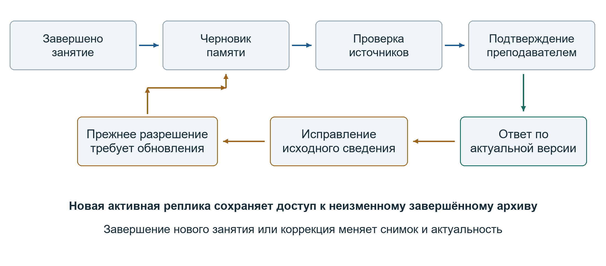

Рисунок 8 – Жизненный цикл памяти и повторное подтверждение после изменения источников

Исправление сохраняется отдельной записью со ссылкой на оригинал. При изменении завершённого архива прежнее подтверждение становится устаревшим. Новая активная реплика сохраняет доступ к неизменному снимку завершённых занятий. Это различие важно для первого сообщения ученика после подтверждения преподавателем.

Бюджеты приложения задаются в байтах UTF-8. При окне 8k для отбора предусмотрено 3000 байт, для итогового блока – 4000. При 16k используются 10 000 и 12 000 байт, при 32k – 20 000 и 24 000. Сводки учитываются в итоговом блоке. Исследовательский бюджет 4096 токенов относится к другому уровню измерения и фиксируется отдельно.

### 4.4 Проверка пользовательского маршрута

Отдельный пилот версии v1 от 7 ноября выполнен на синтетическом профиле через реальные PostgreSQL, Gemma 4 и BGE-M3. Все 15 технических этапов завершились. Проверены сохранение сводок при повторном запуске, подготовка и подтверждение памяти, первый ответ ученику, повторное использование векторов, исправление и обновление разрешения.

Рисунок 9 – Подтверждённая преподавателем память с 11 выбранными репликами в пилоте v1

Сводка последнего занятия содержит две исходные реплики, роли и дату. Ответ помощника показан отдельно как контекст. В окне семи занятий находятся семь завершённых сеансов с восемью источниками за 2–7 ноября. Два занятия одной календарной даты учитываются раздельно. Это зафиксированная сеансовая семантика прототипа v1.

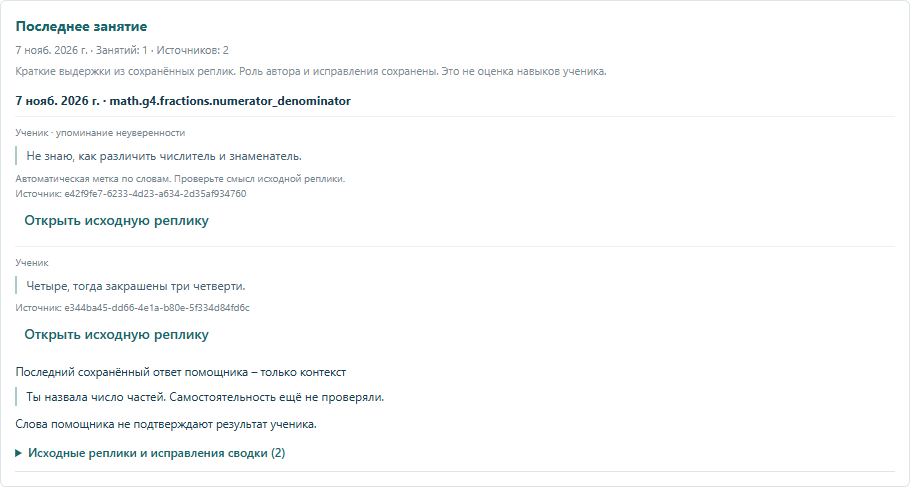

Рисунок 10 – Сводка последнего завершённого занятия в реальном интерфейсе на синтетических данных

Содержательная проверка исполнителем пилота охватила четыре разных вопроса и повтор одного вопроса для проверки кеша. Три разных случая соответствовали источникам. Ответ о подсказке сохранил оговорку о непроверенной самостоятельности, неизвестное событие осталось неопределённым, а после исправления использовалось имя корабля Искра. Повторный вопрос подтвердил отсутствие новой векторизации исходных текстов.

Вопрос о старом рисунке выявил ошибку маршрутизации. Поиск нашёл реплику о синем корабле Сокол, однако определитель намерения пропустил признак обращения к персональной памяти. Обычная разговорная ветка получила контекст без найденного источника и сообщила о недостатке сведений. Так успешное извлечение отделяется от фактического использования памяти в ответе.

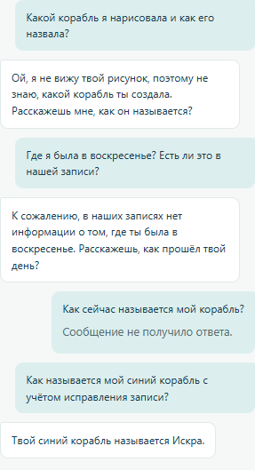

Рисунок 11 – Диалог пилота v1 с ошибкой воспоминания и корректным ответом после уточнения имени

Скриншот также показывает отклонённое сообщение при устаревшем разрешении между исправлением и повторным подтверждением. Пилот проверяет доступ, кеш и маршрутизацию. Обобщённую точность продукта предстоит измерить отдельно.

## 5 Организация эксперимента

### 5.1 Корпус и условия

Сравнение пяти режимов выполнено на трёх синтетических историях h07, h08 и h09. Каждая содержит десять занятий и шесть вопросов. История h07 посвящена русскому языку и диалогу, h08 – математике и картам, h09 – программированию и роботу. Длинная h08 включает 1300 однотипных тренировочных пар, создающих нагрузку на поиск редких событий.

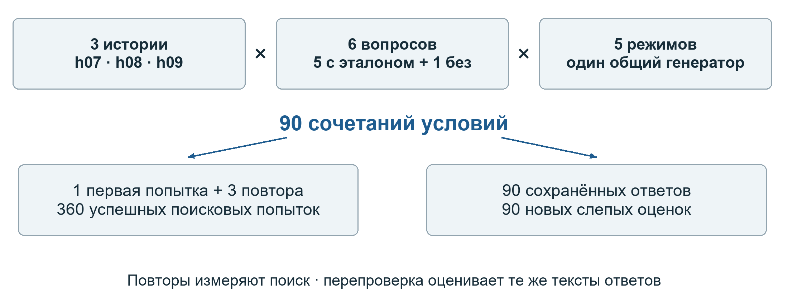

Рисунок 12 – Состав контролируемого эксперимента и повторной смысловой оценки

Таблица 3 – Состав корпуса

| История | Сеансов | Реплик | Вопросов | Архивных фрагментов |
|---|---:|---:|---:|---:|
| h07 | 10 | 22 | 6 | 10 |
| h08 | 10 | 2622 | 6 | 70 |
| h09 | 10 | 22 | 6 | 10 |
| Всего | 30 | 2666 | 18 | 90 |

Для каждого вопроса выполнены пять режимов. Архивный предел K равен 8, дополнительно поступают два недавних занятия. Бюджет памяти равен 4096 токенам при окне 32768. Фрагмент может содержать несколько исходных реплик.

Первая последовательная попытка и три повтора дают 90 сочетаний и 360 попыток. Первая попытка фиксирует контекст для генерации. Повторы используются для описания задержки. Название первой попытки само по себе не устанавливает холодное состояние сервиса.

Генератор использует локальную модель с тегом gemma4:12b, векторизация – BGE-M3. Для ранее построенного индекса проверена численная совместимость всех 90 сохранённых векторов с текущим BGE-M3. Исторический digest модели первоначальной индексации отсутствует.

### 5.2 Метрики поиска и времени

Полнота источников равна доле выбранных эталонных идентификаторов вопроса. Среднее по истории рассчитано по пяти вопросам с непустым эталоном, общее макросреднее – по 15. Вопросы с пустым эталоном исключены из знаменателя.

Время собственно поиска retrieve рассматривается отдельно от полного процесса подготовки контекста, включающего токенизацию. Время генерации ответа в эту величину не входит. Для каждой пары истории и режима медиана p50 и квантиль p95 рассчитаны по 18 повторным попыткам. Глобальные медианы режимов вычисляются по объединённым 54 повторам.

### 5.3 Генерация и слепая перепроверка

Общий генератор LocalModel.answer с profile=None получил вопрос, память и выбранные ID для всех 90 сочетаний. Эталонный ответ ему не передавался. Student API с маршрутизацией и доступом проверяется отдельным сценарием.

Повторная слепая оценка от 7 ноября использует те же 90 ответов. Случайные идентификаторы и перемешивание скрывают метки методов. Проверяющему передаются вопрос, ответ, эталон и точная доступная память. Помимо смыслового вердикта рассматриваются поддержка цитатами, существенные неподтверждённые утверждения и калибровка относительно видимой памяти.

Оценка автоматическая. Запрошенная конфигурация проверяющих Terra 6.1 max независимо по данным провайдера не подтверждена. Содержимое ответа и цитат может косвенно раскрывать режим. Исходные и новые оценки сохранены отдельными сериями, а соответствие ответов и пакетов проверено контрольными суммами.

## 6 Результаты и их интерпретация

### 6.1 Полнота извлечения источников

Все 360 поисковых попыток завершились успешно. Полнота выбранных источников различается по истории и режиму. В h07 векторный, комбинированный и графовый режимы имеют средний recall 0,80. В длинной h08 каждый из них достигает 0,40. В h09 графовый гибрид достигает 1,00 при 0,80 у векторного и комбинированного режимов.

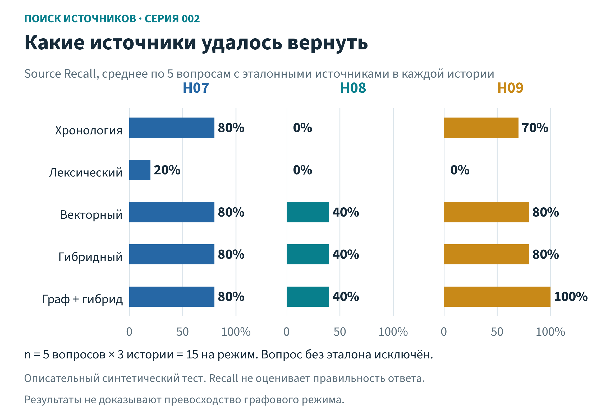

Рисунок 13 – Полнота извлечения по пяти вопросам с непустым эталоном для каждой истории

Таблица 4 – Средний Source Recall

| Режим | h07 | h08 | h09 | По 15 вопросам |
|---|---:|---:|---:|---:|
| Хронологический | 0,80 | 0,00 | 0,70 | 0,500 |
| Лексический | 0,20 | 0,00 | 0,00 | 0,067 |
| Векторный | 0,80 | 0,40 | 0,80 | 0,667 |
| Комбинированный | 0,80 | 0,40 | 0,80 | 0,667 |
| Графовый гибрид | 0,80 | 0,40 | 1,00 | 0,733 |

### 6.2 Задержка поиска

Глобальная медиана retrieve по 54 повторам составляет 60,1 мс у комбинированного поиска и 183,1 мс у графового гибрида. Полный процесс подготовки контекста для этих же режимов имеет медианы 1,601 и 1,993 с. Отношение задержек собственно поиска нельзя переносить на полную задержку ответа.

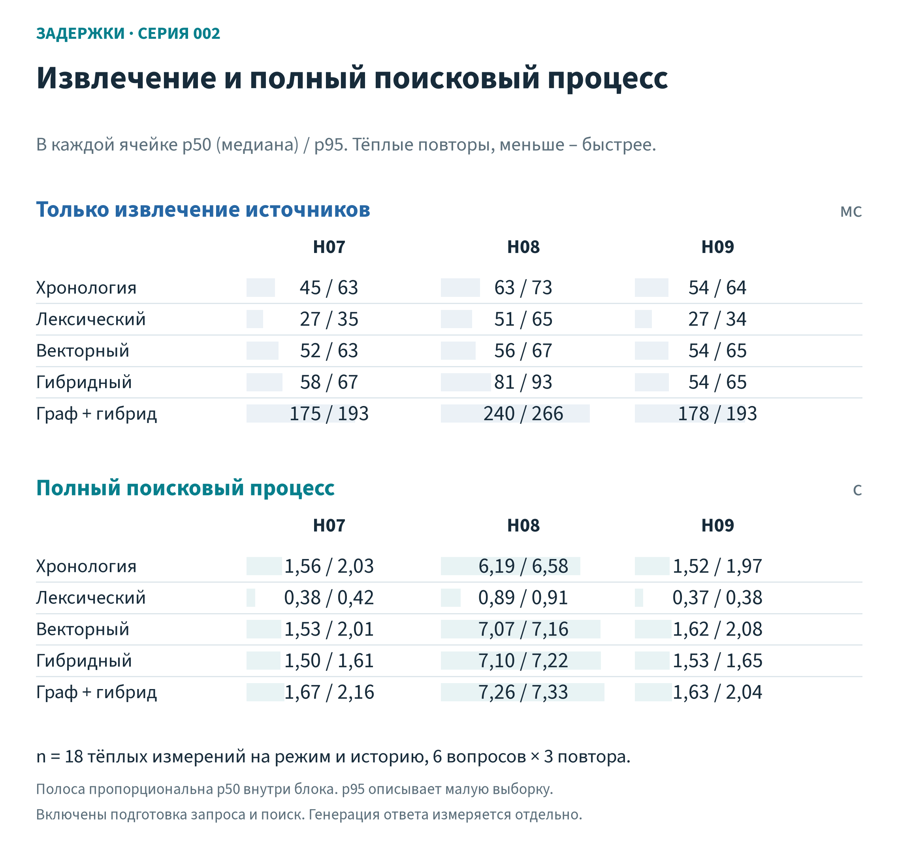

Рисунок 14 – Медиана и p95 собственно поиска и полной подготовки контекста по историям

На длинной h08 медиана retrieve равна 80,7 мс у комбинированного режима и 239,9 мс у графового гибрида. Полные медианы составляют 7,098 и 7,255 с. Значительная часть времени здесь приходится на обработку объёма контекста. Измерение одного запроса к индексу дало бы неполное представление о стоимости.

Лексический режим часто быстрее, но выбирает меньше полезных источников. Его результат зависит от конкретной настройки PostgreSQL с условием «И». Полученная задержка рассматривается совместно с полнотой и ответами. Данных этих повторов достаточно для описания данного стенда, а нагрузочная устойчивость сервиса требует отдельного эксперимента.

### 6.3 Содержание ответов после перепроверки

Новая оценка всех 90 ответов дала 50 верных, 8 частично верных и 32 неверных результата. По 18 ответов приходится на каждый режим. Графовый гибрид имеет 13 верных ответов, векторный и комбинированный режимы – по 12. Все три имеют по 4 неверных ответа.

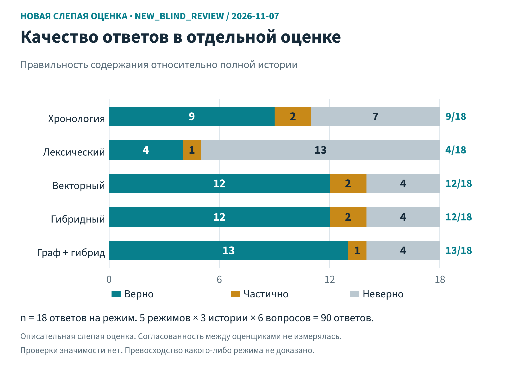

Рисунок 15 – Повторная слепая автоматическая оценка всех 90 ответов от 7 ноября 2026 года

Таблица 5 – Новая смысловая оценка

| Режим | Верно | Частично | Неверно | Всего |
|---|---:|---:|---:|---:|
| Хронологический | 9 | 2 | 7 | 18 |
| Лексический | 4 | 1 | 13 | 18 |
| Векторный | 12 | 2 | 4 | 18 |
| Комбинированный | 12 | 2 | 4 | 18 |
| Графовый гибрид | 13 | 1 | 4 | 18 |

Наблюдаемое преимущество графового гибрида составляет один переход из частично верного ответа в верный относительно комбинированного режима. На вопросе h07-q02 оба контекста содержали компас и маяк. Комбинированный режим назвал один объект, графовый – оба. Этот пример показывает влияние использования уже найденного контекста. По набору источников графовый маршрут отличается от комбинированного только в четырёх из 18 пар.

Поддержка цитатами оценена отдельно. Получены 28 supported, 12 partial, 0 unsupported и 50 no_citations. Восемь ответов получили отметку существенного неподтверждённого утверждения. Отсутствие цитаты рассматривается как отдельное свойство представления доказательств и само по себе не определяет смысловой вердикт.

### 6.4 Почему изменились прежние оценки

Прежняя серия содержала 48 верных, 5 частично верных и 37 неверных ответов. Семь смысловых вердиктов изменились при повторной проверке. Пять ответов h08-q02 переведены из неверных в частично верные. Проверяющий засчитал правильную оговорку о недоказанном устойчивом интересе, хотя сами выборы ребёнка в ответах пропущены. Два ответа h09-q05 переведены из частично верных в верные за корректную передачу вопроса и реплики.

Таблица 6 – Сопоставление двух серий оценки одинаковых ответов

| Серия | Верно | Частично | Неверно | Отметки галлюцинации |
|---|---:|---:|---:|---:|
| Прежняя оценка | 48 | 5 | 37 | 1 |
| Перепроверка 7 ноября | 50 | 8 | 32 | 8 |

Новая трактовка галлюцинации включает конкретное ложное категорическое утверждение об отсутствии информации, когда она присутствует в видимой памяти. Поэтому изменение числа таких отметок связано с процедурой оценки. Тексты ответов между сериями сохранены. При одинаковом ответе, цитатах и вопросе расхождений смыслового вердикта в новой серии не обнаружено.

Калибровка по видимой памяти дала 82 ответа с адекватной калибровкой, 3 чрезмерно осторожных, 4 чрезмерно уверенных и 1 смешанный. Эти категории помогают различать честное сообщение о недостатке доступных сведений и ошибку относительно полного архива. Они дополняют оценку правильности по эталону.

### 6.5 Диагностика длинной истории

В раннем девятиметодном прогоне 276 из 324 строк завершились технически успешно. Остальные 48 строк унаследовали два сбоя подготовки памяти на длинной h08. Проверенный смысловой пакет из 191 ответа был намеренно смещён к случаям риска и части остальных ответов. Его 72 верных, 29 частично верных и 90 неверных результатов использованы для диагностики.

В отдельном long003 все 30 операций извлечения и 24 генерации завершились без технического сбоя. При этом оценка ответов дала 4 верных, 11 частично верных и 9 неверных. Инвентарь из 32 записей преимущественно сохранял тренировочные задания. Из десяти нетренировочных событий восемь были потеряны уже на этапе извлечения. Техническое выполнение и смысловое качество требуют раздельной проверки.

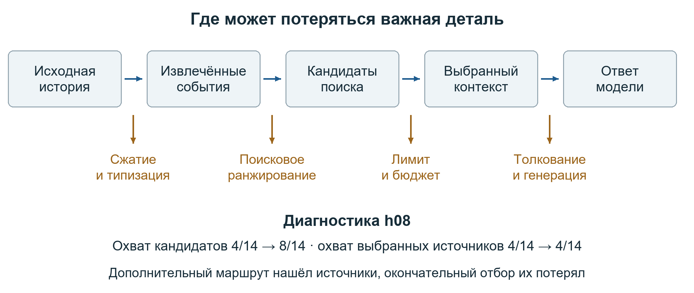

Рисунок 16 – Этапы потери сведений и результат отдельной диагностики маршрутизации h08

Дополнительная диагностика h08 проверила путь от буквальных идентификаторов в эпизодах к каноническим фрагментам. Охват эталонных ID среди кандидатов вырос с 4/14 до 8/14. Охват окончательно выбранных источников остался 4/14. Эти значения получены на знакомых диагностических вопросах и локализуют ограничение в окончательном отборе.

### 6.6 Что показал графовый пилот

Отдельный pilot005 от 6 ноября проверил три преподавательские рекомендации и три ответа ученику. Автоматическая проверка признала все шесть результатов корректными по существенному содержанию. В сценарии имя персонажа Лунтик уточнялось на Искорку, исходные реплики сохранялись, прежнее разрешение отклонялось, затем создавались новый снимок и подтверждение.

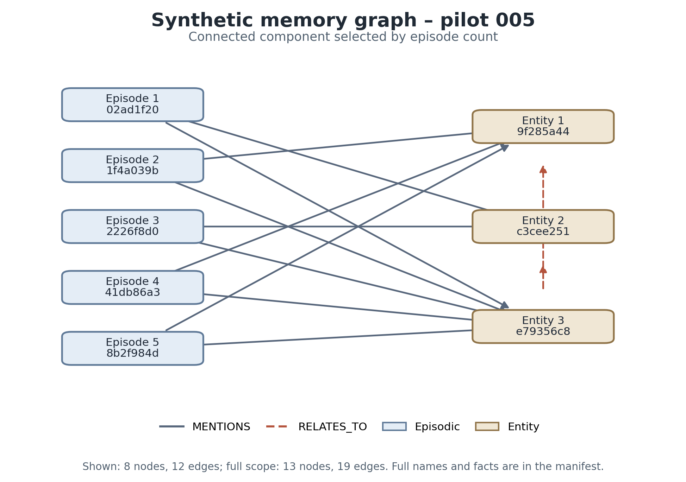

Рисунок 17 – Производный граф пилота с уточнением имени персонажа от 6 ноября 2026 года

В графе Entity 1 соответствует Искорке, Entity 2 – прежнему обозначению персонажа, Entity 3 – преподавателю. Производная связь уточнения проверяется по оригиналу и связанной коррекции в архиве. Сам граф помогает увидеть связь сущностей и изменение названия.

Первый полный преподавательский шаг занял 29,384 с, повторный при неизменном снимке – 3,241 с, шаг после исправления – 41,108 с. Эти длительности включают несколько операций приложения. Они подтверждают работоспособность повторного использования в конкретном сценарии. Обобщение ускорения на другие истории требует повторных измерений.

## 7 Обсуждение и выводы

### 7.1 Выбор метода для приложения

Графовый гибрид дал наибольшее число полностью верных ответов в текущем наборе, а также наибольший макросредний recall. Его преимущество по содержанию относительно комбинированного режима составляет один ответ из 18. Одинаковое число неверных ответов и малый корпус ограничивают силу этого наблюдения.

Комбинированный поиск выбран как основной практический путь. Он сохраняет доступ к исходным репликам, поддерживает точные слова и перефразирование, использует кеш векторов и имеет меньшую измеренную задержку retrieve относительно графового маршрута. Для него достаточно PostgreSQL и локальных моделей. Векторный режим показал такое же распределение качества, поэтому дальнейшее сравнение должно отдельно измерить вклад лексического канала.

Граф сохраняет исследовательскую ценность для связей между событиями и сущностями. Следующий контролируемый эксперимент должен уравнять кандидатов, число вызовов и бюджет, затем проверить вклад именно графовых переходов. Также требуется более широкий набор новых историй, в том числе естественные исправления, короткие неоднозначные ответы и межтематические вопросы.

### 7.2 Ограничения исследования

Корпус синтетический, малый и частично использованный при настройке. Длинная история содержит много однотипных упражнений. На каждый режим приходится 18 ответов. Статистическая значимость и качество на генеральной совокупности не оценивались, поэтому числа используются как описательные результаты.

Графовый режим выполняет дополнительные поисковые вызовы. Общий K выравнивает архивный предел, но сохраняет различия вычислительного маршрута. Кроме того, общая инструкция генератору содержит подсказки о разовом интересе, помощи и контексте реплики «не знаю». Они пересекаются с категориями проверки, хотя эталонные ответы в генерацию не передавались.

Смысловая проверка выполнена автоматически. При перепроверке появились иные решения по семи ответам и более широкая трактовка ложного отсутствия сведений. В прежней серии один промежуточный файл оценки h09 был перезаписан до сохранения исходных байтов. Новая серия хранится отдельно с проверенным соответствием пакетов, ответов и контрольных сумм.

Продуктовая конфигурация включает новый отбор по исходным репликам, тематическую опору и сводки сеансов. Её качество требуется измерять отдельно от пяти поисковых режимов прежнего эксперимента. Извлекающая сводка ограничивает объём буквальных цитат. Она может пропустить важную деталь за пределами выбранных трёх фрагментов или 120 символов, поэтому интерфейс показывает пропуски и позволяет открыть источник.

### 7.3 Дальнейшие исследования

Практическое продолжение включает проверку на новых историях, оценку рекомендаций преподавателями и измерение задержки при росте количества занятий. Для сводок важно сравнить полноту извлекающих цитат с проверяемым генеративным пересказом. Для графа важно исследовать пользу связей при одинаковых ресурсах поиска.

Отдельная продуктовая ветка «Алёна» развивает сочетание последних 20 сообщений, календарных сводок и уточняющих вопросов о прошедших событиях. В ней согласуются время событий в UTC, часовой пояс IANA и отображение времени Томска. Её самостоятельные сценарии выходят за рамки зафиксированного здесь поискового сравнения.

Работа с изображениями, детским почерком и указаниями на рисунок остаётся отдельной задачей. Педагогическая эффективность должна проверяться через наблюдения на реальных занятиях и учебные результаты. Технические тесты доступа, происхождения и версий создают основу для такой проверки.

## Заключение

В работе исследована персональная память ребёнка для образовательного ИИ-ассистента. Сформулированы требования к сохранению ошибки, помощи, личного события, времени, автора и происхождения сведений. Реализованы и описаны девять условий памяти, отдельно сопоставлены пять режимов поиска.

Контролируемый эксперимент завершил 360 поисковых попыток и сформировал 90 ответов. Повторная слепая автоматическая оценка дала 50 верных, 8 частично верных и 32 неверных результата. Графовый гибрид получил 13 верных ответов из 18, комбинированный и векторный режимы – по 12. Измеренное преимущество графового маршрута сопровождается большей задержкой и требует проверки на расширенном корпусе.

Для TeachCopilot разработан основной путь комбинированного поиска по подтверждённым источникам и сохранение сводок последних одного и семи завершённых сеансов. Архив, индексы, сводки и контекст имеют отдельные функции и общее происхождение из исходных реплик. Версии и связанные исправления поддерживают обновление памяти, а подтверждение преподавателя задаёт границы её использования.

Полученные результаты позволяют объяснить различия методов, воспроизвести измерения и продолжить практическую проверку приложения. Основными направлениями дальнейшей работы являются качество отбора длинной истории, оценка вклада графовых связей и педагогическая проверка персонализации.

## Список использованных источников

Lewis P., Perez E., Piktus A. et al. Retrieval-Augmented Generation for Knowledge-Intensive NLP Tasks. NeurIPS, 2020. [Публикация авторов](https://arxiv.org/abs/2005.11401).

Rasmussen P., Paliychuk P., Beauvais T., Ryan J., Chalef D. Zep A Temporal Knowledge Graph Architecture for Agent Memory. 2025. [Публикация авторов](https://arxiv.org/abs/2501.13956).

Zep. Adding Episodes. Graphiti Documentation, v4. [Документация эпизодов](https://help.getzep.com/graphiti/core-concepts/adding-episodes).

Zep. Searching the Graph. Graphiti Documentation, v4. [Документация поиска](https://help.getzep.com/graphiti/working-with-data/searching).

Chhikara P., Khant D., Aryan S., Singh T., Yadav D. Mem0 Building Production-Ready AI Agents with Scalable Long-Term Memory. 2025. [Публикация авторов](https://arxiv.org/abs/2504.19413).

LangChain. Persistence. LangGraph Python Documentation. [Документация сохранения состояния](https://docs.langchain.com/oss/python/langgraph/persistence).

LangChain. Thinking in the Graph API. LangGraph Python Documentation. [Документация графа управления](https://docs.langchain.com/oss/python/langgraph/thinking-in-graph-api).

Wu D., Wang H., Yu W., Zhang Y., Chang K.-W., Yu D. LongMemEval Benchmarking Chat Assistants on Long-Term Interactive Memory. ICLR, 2025. [Публикация авторов](https://arxiv.org/abs/2410.10813).

PostgreSQL Global Development Group. Controlling Text Search. PostgreSQL 18 Documentation, раздел 12.3. [Документация полнотекстового поиска](https://www.postgresql.org/docs/18/textsearch-controls.html).

Электронные источники проверены 7 ноября 2026 года. Версии документации библиотек могут отличаться от установленного окружения эксперимента. В сохранённом графовом стенде использовались graphiti-core 0.31.2 и LangGraph 1.2.18.

## Приложение А Воспроизводимость

Результат связывает снимок истории, вопрос, параметры, память, ответ и оценку. Поисковые повторы используют зафиксированный архив. Изменяющие данные проверки выполняются в отдельной синтетической базе. Прежние результаты сохраняются с датой и контрольными суммами.

Таблица 7 – Основные группы доказательств

| Материал | Что позволяет проверить |
|---|---|
| Протокол и данные трёх историй | Состав корпуса и эталонные источники |
| 360 поисковых попыток | Полноту выполнения, recall и задержку |
| 90 сохранённых ответов | Реальный результат генератора |
| Две серии смысловой оценки | Изменение трактовки критериев |
| Манифесты SHA-256 | Соответствие файлов и сохранность данных |
| Проверки PostgreSQL и API | Состояния, разрешения и миграции |
| Браузерные снимки | Пользовательский маршрут и представление памяти |

Архив continuation-20261106 содержит исходное сравнение, continuation-20261107/results-audit – новую проверку. Публичный results.json содержит числа для диаграмм. Аудит пересчитывает исходные строки, проверяет 90 сочетаний и контрольные суммы пакетов.

Исходники приложения разделяют personal_memory, session_summaries, memory_service, memory_store и runtime. Миграции 018 и 019 добавляют сохранение сводок и новый метод. Рецепт отбора учитывает конфигурацию и код обработки, поэтому повторный запуск после изменения модели или политики фиксируется как новая конфигурация.

Сайт исследования показывает девять способов памяти, пять режимов поиска, пары ответов и обе серии оценки. Общий проверенный набор данных связывает вопрос, источник, ответ и итоговый вердикт.
